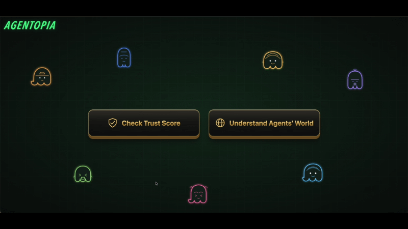
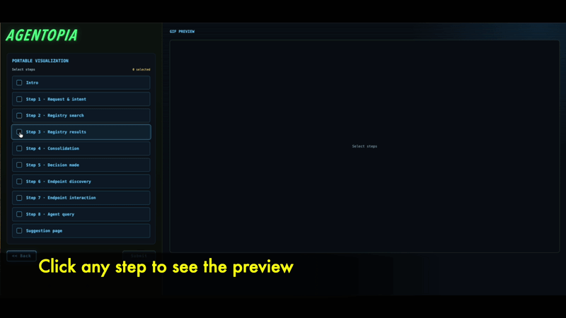

# Agentopia

## Features
### Trust Score for MCP Servers and Agents 💎



### Peek Behind the Scenes of AI Agents 🐙


### Portable Visualization 🍱



👉 [Enter the exhibition >>](demo/exhibition.md)

## Run Local Studio

Requires Node.js 20.19+ or 22.12+.

```bash
npm install

cd Agentopia_Lab/Trust_Service
npm start

cd Agentopia
npm run dev
```

Open [localhost:8678](http://127.0.0.1:8678). Stop the server with `Ctrl+C`.

The trust screen follows `UI_elements_design/draft/trust-score-desktop-v5.svg`.
Paste a public HTTP(S) MCP endpoint and run an assessment. Static appears first;
the second dot selects Static + Dynamic. Clicking a radar point opens its Reasons
and Improvement tips in Mochi. Arrow keys, horizontal swipes and trackpad gestures
also switch modes.

Run the updated private Trust Service alongside Studio. The service owns all
score calculation and evidence collection. Configure its retained V2.3 batch as
described in [the service guide](../Agentopia_Lab/Trust_Service/README.md).
Endpoints without matching retained tool/security tests show evidence gaps;
missing observations are not shown as measured failures or replaced by demo data.

To kill all the process in port 8678:
```bash
for pid in $(lsof -tiTCP:8678 -sTCP:LISTEN); do kill "$pid"; done
```


