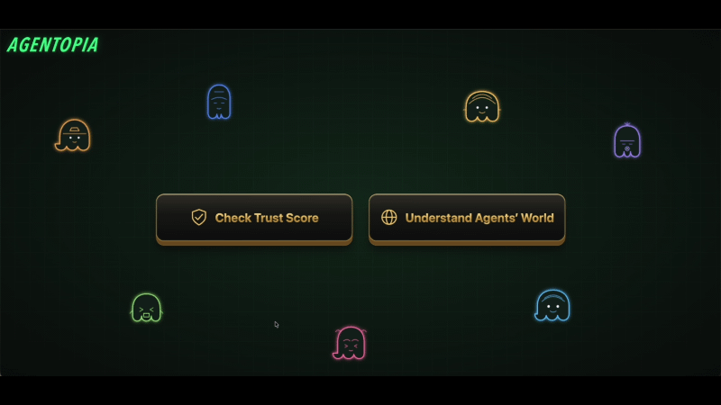

# Agentopia

## Features
### Trust Score for MCP Servers and Agents 🌟



### Peek Behind the Scenes of AI Agents 🐙


### Portable Visualization 🧳


👉 [Enter the exhibition >>](demo/exhibition.md)

## Run Local Studio

Requires Node.js 20.19+ or 22.12+.

```bash
npm install

cd Agentopia_Lab/Trust_Service
npm start

cd Agentopia
npm run dev
```

Open [localhost:8678](http://127.0.0.1:8678). Stop the server with `Ctrl+C`.

To kill all the process in port 8678:
```bash
for pid in $(lsof -tiTCP:8678 -sTCP:LISTEN); do kill "$pid"; done
```


